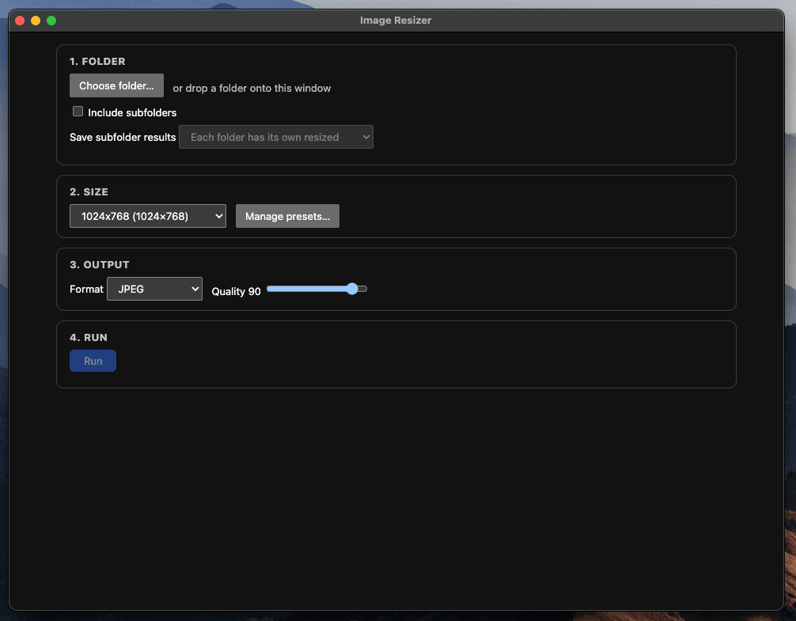
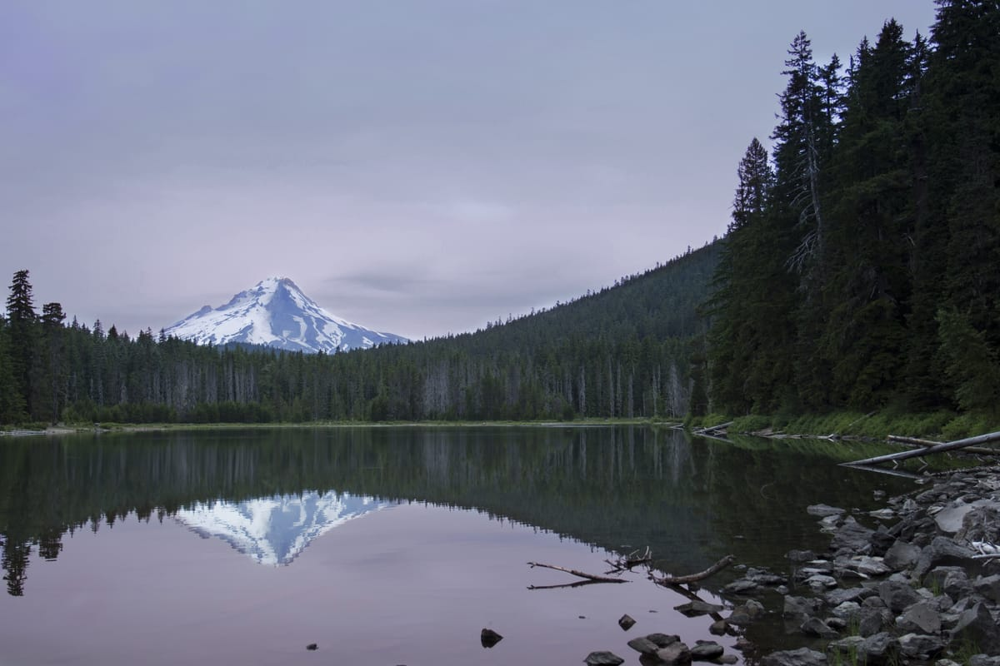
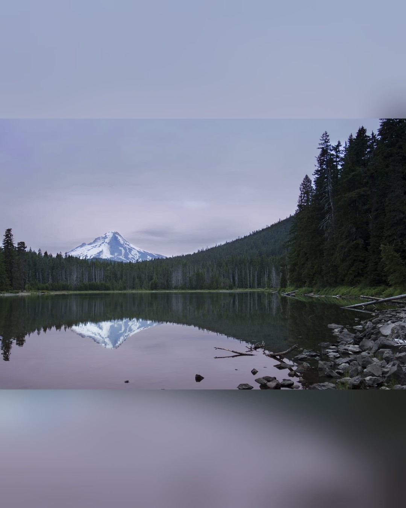
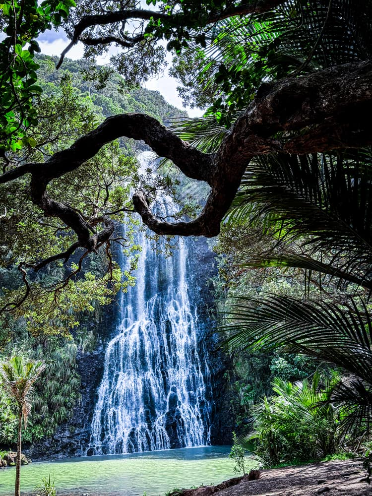
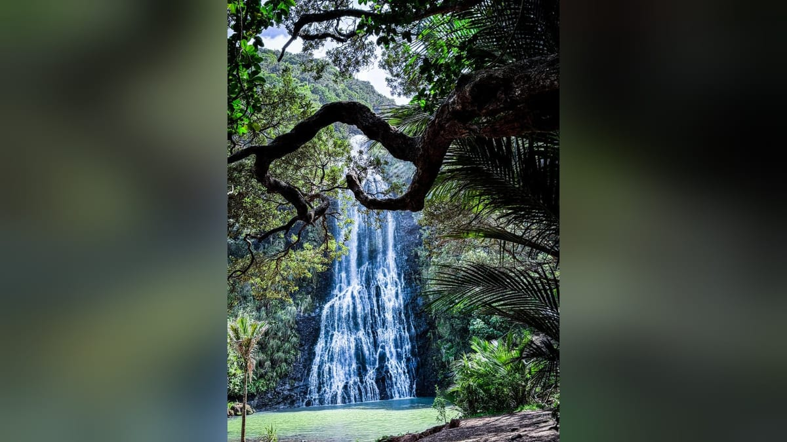

# Image Resizer

Desktop app (macOS) that batch-resizes a folder of photos to a fixed canvas: the whole photo is kept
and empty margins are filled with a blurred copy of the same photo.



## Example

A landscape photo (3:2) fitted onto a 1080×1350 canvas. The whole photo is kept and the empty margins
above and below are filled with a blurred copy of the same photo.

| Before (3:2, landscape) | After (1080×1350) |
| --- | --- |
|  |  |

The opposite case: a portrait photo (3:4) fitted onto a 1920×1080 landscape canvas. The empty margins
on the left and right are filled with a blurred copy.

| Before (3:4, portrait) | After (1920×1080, shown at 1200 px) |
| --- | --- |
|  |  |

Sample photo credits are in [`docs/README.md`](docs/README.md#sample-photo-credits).

Full documentation lives in [`docs/`](docs/README.md).

## Commands

```bash
npm install     # install dependencies
npm start       # build and run the app
npm test        # run unit tests (Vitest)
npm run build   # compile TypeScript to dist/
npm run dist    # build unsigned .dmg and .zip into release/
```

## About

This app was built with [Claude Code](https://claude.com/claude-code) using the
[OpenSpec](https://github.com/Fission-AI/OpenSpec) spec-driven workflow (see [`openspec/`](openspec/)).
